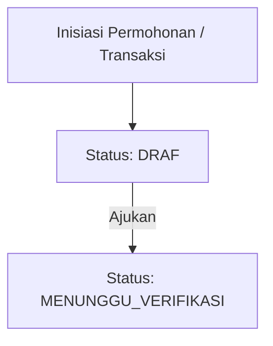

# 02 — Alur Kerja Bisnis, Mesin Status & Protokol Birokrasi

## 1. Peta Proses Bisnis End-to-End
*(Gunakan diagram Mermaid `flowchart TD` atau `sequenceDiagram` dengan label dalam tanda kutip ganda untuk memvisualisasikan alur lintas aktor dari hulu ke hilir).*

## 2. Spesifikasi Mesin Status Deterministik (*State Machine*) per Entitas Utama
### Entitas: `[Nama Entitas Utama]`

| Status Asal | Aksi Pemicu | Aktor Berhak | Syarat Sah Transisi (*Guards*) | Status Tujuan | Kunci Data (*Lock*) | Efek Samping (Nomor/Notifikasi/Saldo/Audit) |
| :--- | :--- | :--- | :--- | :--- | :--- | :--- |
| `DRAF` | `AJUKAN` | `[Aktor]` | `[Syarat lengkap]` | `DIAJUKAN` | `Substansi Terkunci` | `[Efek atomik]` |

## 3. Aturan Birokrasi Khusus, Disposisi & Eskalasi SLA
- **Aturan Routing Dinamis / Ambang Nilai**: `[Misal: Kapan alur melewati persetujuan tambahan berdasarkan nominal/kategori/risiko]`
- **Aturan Revisi Mundur**: `[Jika dikembalikan oleh pejabat level N, kembali ke siapa dan apakah wajib ulang verifikasi dari level 1?]`
- **Aturan Pembatalan / Koreksi Pasca-Sah**: `[Mekanisme resmi tanpa menghapus data historis]`
- **Penomoran Dokumen Resmi**: `[Format nomor, kapan diterbitkan, cara mencegah nomor ganda/bolong]`
- **Batas Waktu (SLA) & Eskalasi Otomatis**: `[Pengingat otomatis atau eskalasi jika berkas menggantung > X hari kerja]`

## 4. Kontrak Jejak Audit Abadi (*Audit Trail Contract*)
- **Peristiwa yang Wajib Direkam**: `[Daftar aksi bisnis & keamanan yang wajib masuk ke tabel audit abadi]`
- **Atribut Wajib per Log Audit**: `[Pelaku, jabatan aktif saat klik, mandat Plt/Plh jika ada, waktu server UTC, nilai sebelum & sesudah, alasan/catatan]`
- **Masa Retensi & Hak Akses Pemeriksa**: `[Siapa yang boleh membaca jejak audit dan berapa lama wajib tersimpan]`

