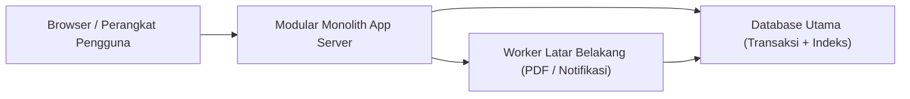

# 01 — Keputusan Arsitektur (ADR), Pemilihan Stack & Topologi Ringan

## 1. Evaluasi Objektif Pemilihan Tech Stack
> Mengacu pada target beban & tim pemelihara di `SCALE_PROFILE.md`.

| Lapis Sistem | Kandidat A | Kandidat B | Pilihan Terpilih | Alasan Teknis, Jejak RAM/Bundle, & Kemudahan Maintenance |
| :--- | :--- | :--- | :--- | :--- |
| **Frontend / UI** | `[...]` | `[...]` | **`[Pilihan]`** | `[Bukti keringanan & kecocokan paradigma UX]` |
| **Backend / Runtime** | `[...]` | `[...]` | **`[Pilihan]`** | `[Estimasi RAM idle, kecepatan, & keamanan tipe]` |
| **Database Utama** | `[...]` | `[...]` | **`[Pilihan]`** | `[Dukungan transaksi, indeks, & fitur bawaan]` |
| **Antrean & Cache** | `[...]` | `[...]` | **`[Pilihan]`** | `[Alasan mengapa tidak over-engineering]` |

## 2. Diagram Topologi Sistem & Aliran Beban
*(Gunakan diagram Mermaid `flowchart LR` atau `flowchart TD` dengan label bertanda kutip ganda).*

## 3. Batas Modul Internal (*Modular Monolith Boundaries*)
| Nama Modul Internal | Tanggung Jawab Tunggal | Tabel yang Dimiliki Eksklusif | Kontrak Layanan Publik ke Modul Lain |
| :--- | :--- | :--- | :--- |
| `mod-identity-mandate` | Autentikasi, unit kerja, jabatan & Plt/Plh | `users`, `org_units`, `positions`, `mandates` | `VerifyActiveMandate()`, `GetUnitScope()` |

## 4. Arsitektur Konfigurasi Kebijakan (*Zero-Hardcode Engine*)
- **Mekanisme Penyimpanan Parameter Kebijakan (`CFG-XX` dari SRS)**: `[Tabel kebijakan bertanggal efektif + cache memori ringan ber-TTL/invalidasi instan]`

## 5. Catatan Keputusan Arsitektur Formal (ADR)
### ADR-001: `[Judul Keputusan Penting]`
- **Konteks Masalah**:
- **Keputusan**:
- **Konsekuensi Positif & Trade-off yang Disadari**:

