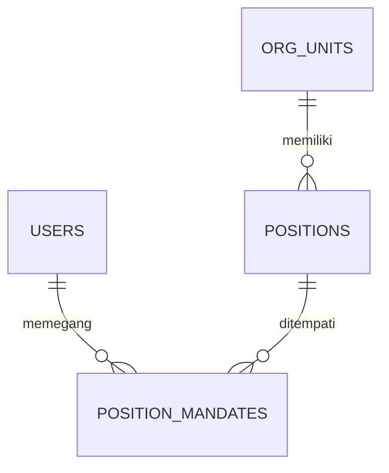

# 02 — Skema Database, Integritas Birokrasi & Peta Indeks

## 1. Diagram Relasi Entitas (ERD)
*(Gunakan `erDiagram` Mermaid untuk memetakan relasi tabel inti, versi dokumen, dan tabel audit).*

## 2. Spesifikasi Tabel, Tipe Data Ketat & Constraint
> Setiap tabel transaksi wajib menjelaskan aturan `ON DELETE` (dilarang `CASCADE` yang menghapus rekam jejak historis secara diam-diam!) dan kolom `version` bila mendukung edit/persetujuan konkuren.

### Tabel: `[nama_tabel]`
| Kolom | Tipe Data Presisi | Null? | Constraint / Default | Keterangan & Klasifikasi Privasi |
| :--- | :--- | :--- | :--- | :--- |
| `id` | `UUID (v7)` / `BIGINT` | `NOT NULL` | `PRIMARY KEY` | Identitas unik berurutan waktu |
| `version` | `INTEGER` | `NOT NULL` | `DEFAULT 1` | Kunci konkurensi optimis |

## 3. Peta Kueri Kritis ke Indeks Komposit (Hukum ESR: Equality, Sort, Range)
> **Syarat Lulus Gate 2**: Tidak boleh ada satu pun halaman daftar, pencarian, atau laporan rutin yang berjalan tanpa indeks penopang di tabel ini.

| Pola Kueri / Layar Pemakai | Filter `WHERE` & Urutan `ORDER BY` | Definisi Indeks Spesifik (Termasuk Partial Index bila relevan) | Strategi Paginasi |
| :--- | :--- | :--- | :--- |
| `[Layar Antrean Verifikasi]` | `unit_id = ?, status = ? ORDER BY sla_at ASC` | `idx_sub_unit_status_sla (unit_id, status, sla_at ASC)` | `Cursor Pagination` |

## 4. Strategi Pengarsipan, Enkripsi Kolom PII & Integritas Audit
- **Perlindungan Tabel `audit_logs`**: `[Skema append-only, larangan hak UPDATE/DELETE pada user aplikasi database bila memungkinkan]`
- **Penanganan Kolom `PII_SENSITIF` dari SRS**: `[Enkripsi aplikasi AEAD + blind index hash untuk pencarian eksak NIK bila diperlukan]`
- **Strategi Pertumbuhan Data 3–5 Tahun**: `[Partisi waktu / pengarsipan lampiran dingin agar tabel aktif tetap ramping di RAM]`

