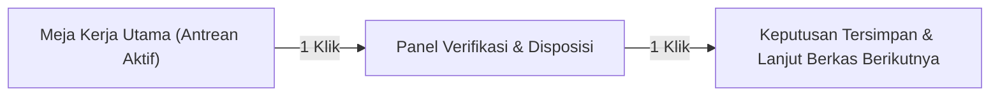

# 01 — Riset Metode UI/UX, Paradigma Tampilan & Arsitektur Informasi

## 1. Profil Ergonomi Kognitif per Kelompok Pengguna
| Aktor (`01-analysis`) | Intensitas & Durasi Sesi | Lingkungan & Perangkat Nyata | Target Kecepatan Kerja & Pencegahan Human-Error |
| :--- | :--- | :--- | :--- |
| `[ACT-01]` | `[Misal: 6 jam/hari di Desktop]` | `[Monitor 1366x768, jaringan kantor]` | `[Memproses 1 berkas < 45 detik tanpa salah klik tolak/setuju]` |

## 2. Pemilihan Paradigma Tampilan UI/UX (Hasil Riset)
- **Paradigma Utama Ruang Kerja / Aplikasi**: `[Misal: Master-Detail Split Triage + Precision Operational Workbench]`
- **Paradigma Portal Publik / Mobile (Jika Ada)**: `[Misal: Radical Civic Clarity / Field-First Mobile]`
- **Alasan Ilmiah & Benchmark Referensi Dunia Nyata**:
  `[Jelaskan mengapa paradigma ini paling memudahkan pengguna memahami sistem dibandingkan tampilan dashboard generik]`
- **Tingkat Kepadatan Antarmuka (*UI Density*)**: `[Tinggi-Operasional / Sedang-Seimbang / Lega-Terpandu]`

## 3. Pemodelan Objek Mental (OOUX)
| Objek Utama di Kepala Pengguna | 4–5 Atribut Pengenal Instan di Daftar | Status Siklus Hidup Visual | Aksi Utama Paling Sering |
| :--- | :--- | :--- | :--- |
| `[Objek]` | `[Kode, Judul, Nilai, Tenggat SLA]` | `[Draf -> Verifikasi -> Terbit]` | `[Periksa & Paraf]` |

## 4. Arsitektur Informasi, Peta Navigasi & Anggaran Kedalaman Klik
*(Gunakan diagram Mermaid `flowchart LR` atau `flowchart TD` untuk memetakan struktur navigasi per peran & membuktikan tugas inti tercapai <= 2 klik).*

## 5. Strategi Anti-Dinding-Teks (*Zero-Text-Wall Transformation Plan*)
| Area yang Biasanya Penuh Teks di Aplikasi Lain | Solusi Visual Ringkas di Sistem Ini |
| :--- | :--- |
| `[Misal: Penjelasan syarat & alur pengajuan panjang]` | `[Diganti pita progres 4-tahap + checklist syarat otomatis]` |

